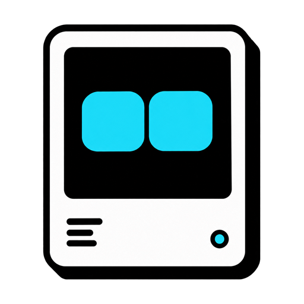
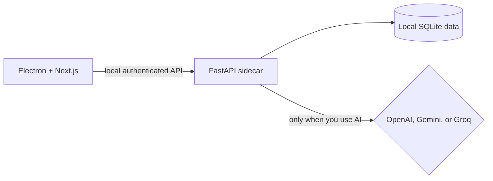

<div align="center">

<h1> PomoPet</h1>

### A tiny AI focus companion that lives on your desktop

Plan what matters, run focused sessions, and build better work habits with a pet that stays by your side — without sending your productivity data to a cloud database.

[](https://github.com/egoist-minh/pomopet/stargazers)
[](https://github.com/egoist-minh/pomopet/releases/latest)
[](#download)

[Download](#download) · [Screenshots](#-screenshots) · [Feature highlights](#-feature-highlights) · [Build from source](#build-from-source) · [Roadmap](#roadmap)

</div>

> [!NOTE]
> PomoPet is in active development. The first public Windows release is being prepared; early testers and contributors are very welcome.

## Why PomoPet?

Most Pomodoro apps disappear into a browser tab. PomoPet keeps a small, draggable companion on top of your windows so your current task and remaining time stay visible without taking over your screen.

## 📸 Screenshots

<p align="center">
  
  <br />
  <sub>Chat with Pomo, preview a task change, and confirm it before anything is applied.</sub>
</p>

<table>
  <tr>
    <td width="50%" align="center">
      
      <br />
      <sub>A compact companion that stays nearby without covering your workspace.</sub>
    </td>
    <td width="50%" align="center">
      
      <br />
      <sub>Contextual nudges appear in a lightweight desktop speech bubble.</sub>
    </td>
  </tr>
</table>

## ✨ Feature highlights

| | Feature | What it gives you |
| --- | --- | --- |
| 🐾 | **Expressive desktop companion** | Keep a draggable, always-on-top pet nearby with ambient routines, reactions, quick actions, and a focus timer that stays in sight. |
| 🍅 | **Adaptive focus sessions** | Pause, resume, cancel, extend, or finish early; split long tasks into a focus series with planned breaks while preserving the remaining work. |
| 🗓️ | **Goal-to-today planning** | Shape goals into monthly milestones, weekly outcomes, and daily focus items, with an inbox for work that is not scheduled yet. |
| ✨ | **Reviewable AI planning** | Ask Pomo to break down or revise a plan, inspect the proposed structure, edit it, and approve it only when it fits. |
| 💬 | **Actionable streaming chat** | Get readable, streamed guidance and preview single or batched task and plan changes before explicitly confirming them. |
| 🧭 | **A consistent point of view** | Pomo gives practical recommendations, calls out overloaded or fragile plans, and can respectfully disagree instead of mirroring every idea. |
| 🧠 | **Personalized discovery and memory** | Optional questions, preferences, habit signals, rituals, and shared moments help Pomo tailor suggestions without silently changing its core values. |
| 💡 | **Context-aware proactive nudges** | Receive bounded reminders, planning suggestions, encouragement, discovery questions, and lightweight companion moments when they are useful. |
| 📊 | **Focus and distraction insights** | Review daily and weekly focus progress, completed sessions, distraction patterns, and the current distraction chain. |
| 🔒 | **Local-first privacy controls** | Keep productivity data in local SQLite and inspect, edit, suppress, disable, or delete what Pomo remembers. |
| ⚡ | **OpenAI, Gemini, or Groq** | Choose your preferred provider and protect API keys entered in the desktop app with the operating system's secure storage. |

## Download

PomoPet currently targets **Windows 10/11**.

The installer will be available on the [GitHub Releases page](https://github.com/egoist-minh/pomopet/releases) with the first public release. The packaged app includes its backend, so end users do not need Python or Node.js.

Want to try it before then? Follow the build-from-source guide below and tell us what feels delightful — or what gets in the way — in [GitHub Issues](https://github.com/egoist-minh/pomopet/issues).

## How it works



PomoPet runs as an Electron desktop app with a bundled FastAPI sidecar. The sidecar binds to a free loopback port and accepts authenticated requests from the app. Your productivity history remains local; when an AI feature is used, only the context needed for that request is sent to the provider you selected.

## Build from source

### Prerequisites

- Windows 10/11
- [Node.js](https://nodejs.org/) with npm
- [Miniconda or Anaconda](https://docs.conda.io/projects/miniconda/en/latest/)
- An OpenAI, Gemini, or Groq API key if you want AI chat and planning

### Setup

```powershell
git clone https://github.com/egoist-minh/pomopet.git
cd pomopet

conda create -n pomopet python=3.11 -y
conda activate pomopet
pip install -r backend/requirements.txt
Copy-Item backend/.env.example backend/.env

cd frontend
npm ci
cd ..
npm run dev
```

You can also double-click `run.bat` after setup. One terminal starts FastAPI, Next.js, and Electron; closing Electron or pressing `Ctrl+C` stops the other processes.

Open **Config** inside PomoPet to select OpenAI, Gemini, or Groq and add a key. In Electron, keys entered through the UI are encrypted with the OS secure store. For development, you may instead set `OPENAI_API_KEY`, `GEMINI_API_KEY`, or `GROQ_API_KEY` in `backend/.env`.

> [!IMPORTANT]
> AI features call the provider you choose and may incur usage charges. Timers, planning data, tasks, and statistics do not require an AI key.

## Build the Windows app

Install the packaging dependencies once:

```powershell
conda run -n pomopet python -m pip install -r backend/requirements-build.txt
```

Then build from the repository root:

```powershell
npm run build    # Build the static renderer
npm run package  # Create an unpacked Windows app
npm run dist     # Create the NSIS installer
```

Artifacts are written to `dist/`. The packaged application includes the Python backend and stores its databases and logs in Electron's per-user data directory.

## Tests and release checks

```powershell
npm test
conda run -n pomopet --cwd backend python -m unittest discover -s tests

# Run after packaging
powershell -NoProfile -ExecutionPolicy Bypass -File scripts/smoke-backend.ps1
powershell -NoProfile -ExecutionPolicy Bypass -File scripts/smoke-packaged-app.ps1
```

## Tech stack

- **Desktop:** Electron
- **Frontend:** Next.js 15, React 19, TypeScript, Tailwind CSS, Motion, Recharts
- **Backend:** Python, FastAPI, SQLAlchemy
- **AI:** LangGraph with OpenAI, Gemini, and Groq
- **Storage:** SQLite, stored locally
- **Packaging:** PyInstaller and electron-builder

## Roadmap

- [x] Floating pet widget and focus timer
- [x] Tasks, goals, and multi-horizon planning
- [x] AI chat and reviewable planning actions
- [x] Local preferences, habit suggestions, and relationship memory controls
- [x] Focus and distraction statistics
- [ ] First signed public Windows release
- [ ] macOS and Linux support
- [ ] More pet appearances and animations
- [ ] Import/export and optional backup
- [ ] Local-model support

The roadmap is shaped by real usage. If a feature matters to you, [open an issue](https://github.com/egoist-minh/pomopet/issues) and share the workflow you want PomoPet to support.

## Contributing

Bug reports, product feedback, documentation fixes, and pull requests are welcome. Before starting a large change, please open an issue so we can align on the behavior and scope.

Developer notes and architecture decisions live in [`docs/`](./docs/).

## Privacy

PomoPet does not require an account or cloud sync. Its productivity and personalization data is stored locally. You can disable personalization, inspect or edit remembered preferences, mark something as never mention, or delete relationship data from **Config → What Pomo remembers**.

OpenAI, Gemini, and Groq have their own data-handling policies. When you use an AI feature, the selected provider receives your prompt and the limited context needed to answer it.

## License

A license has not been selected yet. Until one is added, the source code remains copyright-protected and is not licensed for redistribution or reuse.

---

<div align="center">

If PomoPet makes focused work feel a little less lonely, consider giving the project a ⭐. It helps more people discover it.

</div>
